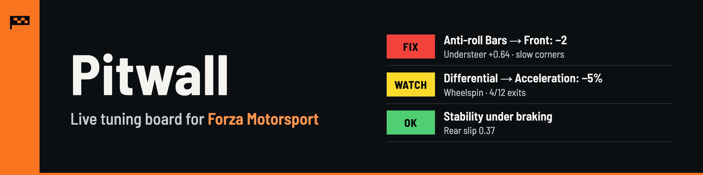
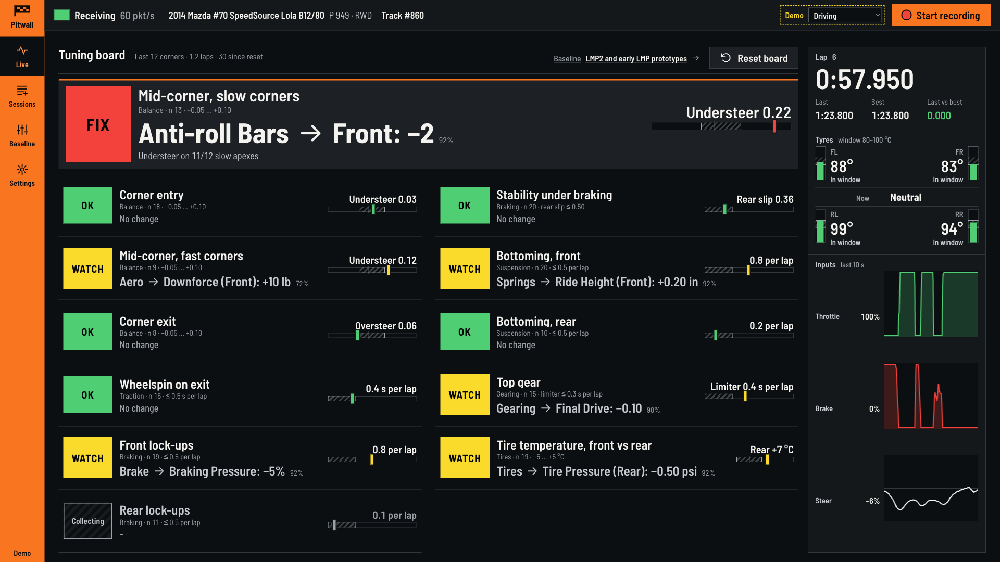
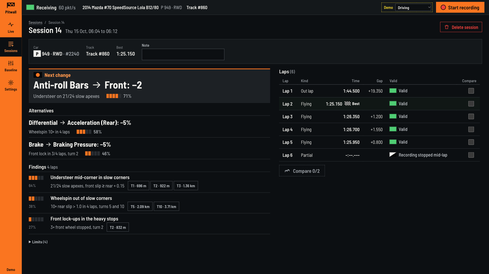
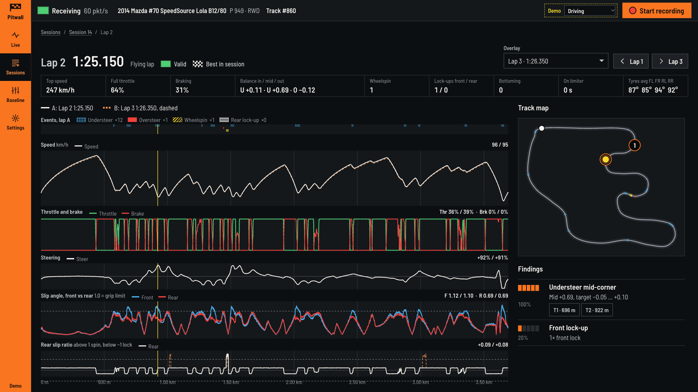
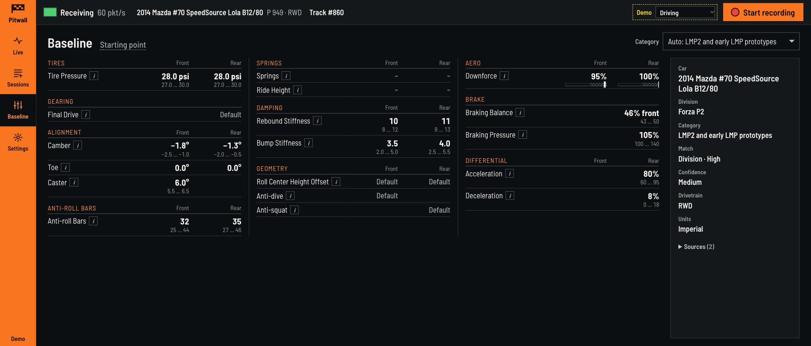

<p align="center"></p>

<p align="center">
  <a href="https://github.com/yukij3/forza-pitwall/actions/workflows/ci.yml"></a>
  <a href="LICENSE"></a>
  
  
</p>

Pitwall reads Forza Motorsport's Data Out telemetry while you drive and shows
which setting to change next, in the words of the game's tuning menu.

> **Status:** early development (0.1). The API and the stored data format may
> still change between versions.

<p align="center">
  <br>
  <sub>Live tuning board</sub>
</p>

## How it works

1. **Drive.** Pitwall rates 12 handling items over your last ~12 corners.
2. **Read the board.** Each item shows a status and the setting to change, e.g. `Anti-roll Bars → Front: −2`.
3. **Change one setting** in the game, press **Reset board**, drive again.

## Features

- **Live tuning board** for a second screen. Items: corner entry, mid-corner
  (slow and fast corners), exit, wheelspin on exit, front and rear lockups,
  stability under braking, front and rear bottoming, gearing, tire temperature
  front vs rear. Status is OK, Watch, Fix or Collecting (green, yellow, red,
  grey); one item is the focus. It resets itself when you change car or track.
- **Advice in menu terms**: one setting, a direction and a step (`−2`, `+5%`),
  only for settings that exist on the car's drivetrain.
- **Car recognition**: 681 cars by name and division.
- **Baseline setups**: starting values for 16 car categories covering all 51
  divisions, picked for the detected car. You can pick another category.
- **Recording** of sessions and laps, split automatically across grid starts,
  rewinds and race finishes. Optional auto-record.
- **Lap and session analysis**: one next change plus up to two alternatives,
  lap charts, lap comparison.
- **Calibrated on real recordings**: lockups are a stopped wheel (works with
  ABS on), timing follows the race clock at the PC's 120–160 packets/s, and
  balance confidence accounts for gamepad steering.
- **Raw packets are kept**, so `python -m pitwall reindex` can rebuild laps and
  analysis after an update.
- **Self-contained**: one container, SQLite, no accounts, no cloud, works
  offline.

<p><br>
<sub>Session analysis</sub></p>

<table>
  <tr>
    <td width="50%" valign="top"><br><sub>Lap detail: speed, inputs, slip and track map</sub></td>
    <td width="50%" valign="top"><br><sub>Baseline setup for the detected car</sub></td>
  </tr>
</table>

<sub>Screenshots: demo mode (`/?mock=1`).</sub>

## Windows app

The simplest way to run Pitwall on the gaming PC itself: one `.exe`, no Python
or Docker.

1. Download `forza-pitwall-<version>-windows-x64.exe` from
   [Releases](https://github.com/yukij3/forza-pitwall/releases) and run it. It
   opens the Pitwall UI in its own window; closing the window stops Pitwall.
2. In the game, set **Data Out IP Address** to `127.0.0.1`, **Data Out IP
   Port** to `5300` and **Data Out Packet Format** to **Car Dash** (see
   [Set up Data Out in the game](#set-up-data-out-in-the-game)).

Notes:

- **SmartScreen** warns about the download because the exe is not code-signed:
  choose **More info → Run anyway**.
- **Windows Firewall** asks on first launch because Pitwall listens on UDP 5300.
  With the game on the same PC you can decline; if the game runs on another
  PC (or an Xbox) on your network, allow **private networks** and send Data Out
  to this PC's LAN IP instead of `127.0.0.1`.
- The window uses **Microsoft Edge WebView2**, which is preinstalled on
  Windows 10 and 11.
- Data (database, recordings, `pitwall-desktop.log`) is stored in
  `%LOCALAPPDATA%\forza-pitwall`. The usual `PITWALL_*` environment variables
  still apply, e.g. `PITWALL_DATA_DIR` or `PITWALL_UDP_PORT`.
- **Microsoft Store / Xbox app version of the game**: Forza Motorsport (2023)
  officially supports sending Data Out to `127.0.0.1`, and its Store package is
  a full-trust desktop app, so Windows' loopback block for sandboxed Store apps
  should not apply. If no packets arrive on `127.0.0.1` anyway, send to the
  PC's LAN IP, or allow loopback for the game once from an administrator
  terminal: `CheckNetIsolation LoopbackExempt -a -n=Microsoft.ForzaMotorsport_8wekyb3d8bbwe`.

## Quick start (Docker Compose)

You need Docker with Compose v2 on a machine in the same local network as the
device running the game. That can be the gaming PC itself.

```bash
git clone https://github.com/yukij3/forza-pitwall.git
cd forza-pitwall
mkdir -p data
```

Open `compose.yaml` and set `PITWALL_PUBLIC_HOST` to the LAN IP address of this
machine (for example `192.168.1.20`; `ipconfig` on Windows, `ip -4 addr` on
Linux). Then start it:

```bash
docker compose up -d --build
```

Open `http://<that IP>:5301` in a browser. The database and recordings are
stored in `./data`. Telemetry comes in on UDP port 5300; both ports can be
changed, see [docs/install.md](docs/install.md).

## Set up Data Out in the game

In Forza Motorsport, open **Settings → Gameplay & HUD** and scroll down to
**UDP Race Telemetry**:

| Option | Value |
|---|---|
| Data Out | On |
| Data Out IP Address | the LAN IP of the machine running Pitwall |
| Data Out IP Port | 5300 |
| Data Out Packet Format | Car Dash ("Dash" in the official documentation) |

If Pitwall runs on the same PC as the game, `127.0.0.1` also works. The game
sends only while you are on track. If the UI shows no packets while you drive,
see [Troubleshooting](docs/install.md#troubleshooting-no-packets).

## Running on a home server or NAS

Publish 5300/udp and 5301/tcp, map a persistent folder to `/data` and set
`PITWALL_PUBLIC_HOST` to the server's IP. [docs/install.md](docs/install.md)
covers `docker run`, Unraid-style templates, file permissions and firewalls.
Pitwall has no login: keep it on your local network and do not forward its
ports to the internet.

## What Data Out cannot see

- **Tire pressure** and **temperature across the tread**: one temperature per
  tire, no pressures, so camber can't be judged. Use the game's telemetry
  screens for those.
- **Your current tune**: advice is a relative step (`−2`), not a target value.
- **Track names**: only numeric IDs. Car names come from a bundled list.
- **Lap validity**: track-limit penalties aren't reported; Pitwall only
  detects rewinds and pauses.
- **Driver aids**: ABS and traction control state aren't sent.

Where these gaps affect a recommendation, Pitwall says so instead of guessing.

## Roadmap

- **Tune sheet and change verification**: target values instead of steps, and
  a check of whether the last change helped.
- **Helper on the gaming PC**: reads the tuning screen; later applies changes
  through a virtual gamepad. Menu input only, never memory editing.
- **More calibration on real data**: wheels, ABS off, other car types.

## Development

Requires Python 3.12 and [uv](https://docs.astral.sh/uv/).

```bash
uv sync                            # dependencies, including dev tools
uv run pytest                      # tests
uv run ruff check .                # lint
uv run python -m pitwall serve     # UDP 5300, web UI on http://localhost:5301
uv run python -m pitwall simulate  # synthetic telemetry, in a second terminal
```

`python -m pitwall replay <file>` plays back a recorded packet file, and
`python -m pitwall reindex` rebuilds laps from them. Demo mode,
`http://localhost:5301/?mock=1`, fakes the API and the live feed in the
browser.

The Windows app is built by the `Windows app` workflow; to build it locally on
Windows: `uv sync --group desktop`, then
`uv run pyinstaller --noconfirm packaging/windows/pitwall.spec`. The exe lands
in `dist\`; `forza-pitwall.exe --smoke` checks it without opening a window
(exit code 0 or 1, details in `pitwall-desktop.log` in the data directory).
See [CONTRIBUTING.md](CONTRIBUTING.md) and
[docs/architecture.md](docs/architecture.md).

## Project layout

```
pitwall/
  telemetry/    Data Out packet format, UDP receiver, lap splitting, Frame model
  storage/      SQLite database and raw packet files
  analysis/     lap and session analysis, live tuning board, rulebook (no I/O)
  baselines/    car list and baseline setups per car category (bundled JSON)
  services/     recorder, live board runner, analysis runner and result cache
  api/          REST and WebSocket API (FastAPI)
  tune/         tune settings in the game's menu order, with in-game names
  tools/        simulator, replay and reindex
  app.py        application wiring
  config.py     configuration from environment variables
  __main__.py   command line: serve, simulate, replay, reindex
  desktop.py    Windows app: server in a background thread, native window
packaging/      Windows app build: PyInstaller spec and icon
web/            browser UI: plain HTML, CSS and JavaScript, no build step
tests/          pytest suites, one folder per area
docs/           installation, architecture, API, storage, analysis, baselines
```

## Disclaimer

Pitwall is an independent fan project. It is not affiliated with, endorsed by or
sponsored by Microsoft, Turn 10 Studios or Playground Games. Forza and Forza
Motorsport are trademarks of Microsoft Corporation and are used here only to
describe what the software works with.

## License

[MIT](LICENSE). The bundled car list is based on
[bluemanos/forza-motorsport-car-track-ordinal](https://github.com/bluemanos/forza-motorsport-car-track-ordinal)
(MIT); see [docs/baselines.md](docs/baselines.md).
